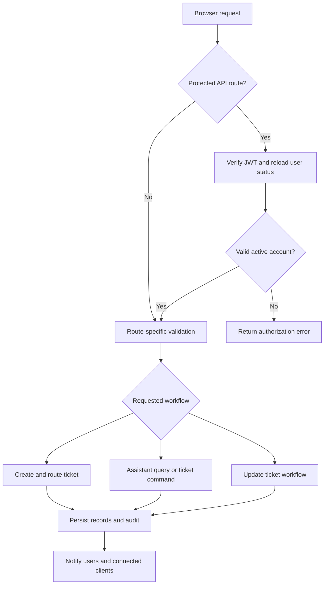
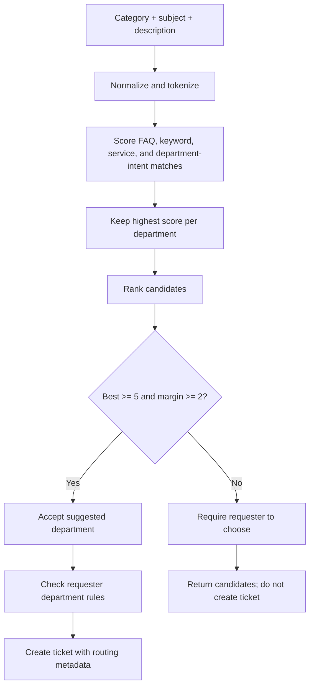

# AssistDesk System Algorithms

This document describes the main implemented decision flows in AssistDesk. It is based on the server code and project routing notes. It is an implementation overview, not a claim that the system uses machine learning for every decision.

## 1. High-level request flow

## 2. Authentication and authorization

### Registration and verification

1. The API normalizes the email, validates required fields, role, department, and applicable student number.
2. It enforces the password policy and hashes the password with bcrypt.
3. A new account is created as `pending_verification`; a generated verification code is stored as a SHA-256 hash and emailed to the user.
4. On verification, the submitted code is format-checked and compared with the stored hash using a timing-safe comparison. A successful verification activates the account, clears the code, records an audit event, and returns a signed JWT.

### Protected requests

1. Protected routes require a Bearer token.
2. The API verifies the JWT signature, algorithm, issuer, and audience.
3. It reloads the user from the database, checks the session version and current account status, then attaches the user identity and role to the request.
4. Route/controller authorization checks role and department scope for the requested operation.

This means the client’s displayed controls are not the authorization boundary; server middleware and controller checks enforce access.

## 3. Ticket department-routing algorithm

The system uses a deterministic, vocabulary-based scoring heuristic. It does not use a trained classifier.

### Inputs and matching

The router combines the ticket category, subject, and description, then normalizes text to lowercase alphanumeric tokens. It removes common stop words and scores matches against:

- FAQ questions and FAQ keywords;
- service names and service requirements;
- configured department aliases and topic phrases.

FAQ question tokens have weight 3, FAQ keyword tokens weight 2, and an included full FAQ question phrase adds 8. Service-name tokens have weight 3 and requirement tokens weight 1. Matching department intent can add a deterministic intent score; an explicit department-name/alias mention scores 100. For each department, the router retains its highest matching score rather than adding every matching record together.

### Acceptance rule

The scores are sorted descending. The top department is accepted automatically only when:

- its score is at least 5; and
- its score is at least 2 points higher than the runner-up.

The recorded confidence is `min(1, best score / 12)`. It is a heuristic indicator, not a calibrated probability.

If the requester explicitly selects a valid department, that selection is used instead of the automatic result, but the department-access rules still apply. For students with a mapped college/program, submission to another mapped college is denied. Maintenance requests additionally require a validated JPEG, PNG, or WEBP image. Ticket creation records the selected/suggested department, routing method, heuristic confidence, initial status, ETA, a ticket update, and an audit entry in a transaction. Notifications are sent after creation.

## 4. Assistant question-answering algorithm

The assistant endpoint first checks for ticket commands (submit request, ticket ID/code lookup, or recent ticket status). Otherwise, it follows the knowledge-answer flow:

1. Validate the message and normalize/cap optional context and suggested keywords.
2. If the message is outside the supported school scope, return the out-of-scope response, except for recognized department-location and office-fact questions.
3. Load FAQ and service records. Handle supported office-fact requests, exact normalized FAQ matches, and recognized department-location requests directly.
4. Apply specific deterministic rules for supported cases such as student IDs, registrar documents, class schedules, and TOR requests.
5. Rank FAQ and service matches. FAQ ranking considers exact/normalized question similarity, matching question tokens and FAQ keywords, and department intent. Service ranking considers tokens in service name, requirements, and processing time, plus department intent.
6. For compound questions, split the query into recognized question parts, retrieve sufficiently scoring matches for each part, and combine distinct results when multiple matches are found.
7. A normal match is treated as confident when the best score is at least 5 and is not within 2 points of the runner-up. If confidence is insufficient, the API optionally asks Gemini to answer using the supplied institutional context when `GEMINI_API_KEY` is configured. If Gemini is unavailable or yields no answer, it returns up to three likely FAQ/service clarification options, or directs the user to provide more detail or submit a ticket.
8. For a confident local match, return the matched FAQ answer or service details and identify the source. When the query is Filipino/Taglish, the API may optionally ask Gemini to translate or restate the official answer while instructing it to use only that answer. Failure to localize does not replace the original grounded answer.
9. Save the user message, response, and matched department/FAQ/service IDs to the chat log.

The assistant therefore primarily retrieves and returns institution-maintained information. Gemini is an optional generation/localization path, not the ticket-routing algorithm or the only source of answers.

## 5. Ticket lifecycle and assignment

- New tickets start as `open`. Default priority is `medium`; initial ETA is 48 hours for medium, 24 hours for urgent, or 72 hours for low priority.
- Only authorized staff/admin users within their department scope can manage a ticket. Staff can assign within their department to active staff; department-scoped administrators are restricted to their scope.
- Assigning an open ticket moves it to `pending`.
- Status transitions are enforced sequentially: `open` → `pending` → `in_progress` → `resolved` → `closed`. Invalid jumps are rejected.
- Department routing corrections are restricted to global administrators in the controller. A correction clears the previous assignment and records the prior/new department and reason in the ticket history and audit log.
- Important workflow updates use database transactions and create audit/ticket-history records. Notifications and Socket.IO events inform the requester and relevant department staff/admins.

## 6. Overdue ETA escalation

At server startup, the API runs an ETA monitor immediately and then at `ETA_MONITOR_INTERVAL_MS` intervals (default: 60 seconds). It prevents overlapping monitor runs within that process.

For each candidate ticket, the monitor selects tickets that are not urgent, are not resolved or closed, and have an ETA at or before the current time. It then rechecks the ticket under a database row lock and transaction. If it is still overdue and eligible, the system:

1. changes its priority to urgent;
2. writes a ticket update and audit event;
3. notifies the requester and applicable department administrators/staff (including configured push delivery through the notification model);
4. sends ETA-expired email where email delivery is configured; and
5. emits real-time events, including a campus-map refresh.

The scheduled polling is process-local; this implementation does not, by itself, establish a distributed single-monitor guarantee across multiple API instances.

## 7. Key implementation references

- Authentication and registration: [../server/controllers/authController.js](../server/controllers/authController.js)
- JWT and account-status validation: [../server/middleware/auth.js](../server/middleware/auth.js)
- Authentication routes: [../server/routes/authRoutes.js](../server/routes/authRoutes.js)
- Ticket routing scores and thresholds: [../server/utils/departmentRouting.js](../server/utils/departmentRouting.js)
- Ticket creation, status transitions, assignment, and ETA escalation: [../server/controllers/ticketController.js](../server/controllers/ticketController.js)
- Ticket routes: [../server/routes/ticketRoutes.js](../server/routes/ticketRoutes.js)
- Assistant retrieval, ticket commands, and Gemini integration: [../server/controllers/aiController.js](../server/controllers/aiController.js)
- Exact FAQ matching: [../server/utils/exactFaqResponse.js](../server/utils/exactFaqResponse.js)
- Assistant response constraints: [../server/utils/assistantSystemInstruction.js](../server/utils/assistantSystemInstruction.js)
- ETA monitor startup and interval: [../server/server.js](../server/server.js)
- Routing policy overview: [../SMART_ROUTING.md](../SMART_ROUTING.md)
