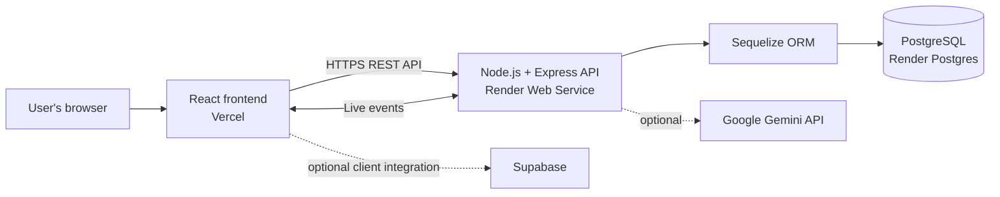

# AssistDesk Technology Stack

This document summarizes the technologies used by the current AssistDesk implementation. It reflects the repository manifests and the documented production deployment; optional and legacy components are identified separately.

## Architecture at a glance



## Core technologies

| Layer | Technology | Use |
|---|---|---|
| Frontend | React 18.3, JavaScript, Create React App (`react-scripts`) | Single-page web application and user interface |
| Frontend routing and requests | React Router 6, Axios | Client-side navigation and HTTP API requests |
| Backend | Node.js 22, Express 5 | REST API, application logic, and server-side authorization |
| Data access | Sequelize 6 | Relational models, associations, and database access |
| Production database | PostgreSQL (`pg`, `pg-hstore`) | Persistent application data, hosted on Render Postgres |
| Real-time communication | Socket.IO 4 (server and client) | Live application events and updates |
| Hosting | Vercel and Render | Vercel serves the frontend; Render runs the API and PostgreSQL database |

## Supporting libraries and features

- **UI and motion:** Tailwind CSS 3, Poppins via Fontsource, GSAP, and Lenis.
- **Maps:** Leaflet and React-Leaflet; the campus visualization also includes a standalone 3D map page.
- **Authentication and security:** JSON Web Tokens (`jsonwebtoken`), `bcryptjs` for password hashing, Helmet for security headers, CORS configuration, and Express rate limiting.
- **Email and push:** Nodemailer for configured email workflows and `web-push` for optional browser push notifications.
- **Configuration:** `dotenv` for local environment variables. Secrets and database URLs are configured on the server/hosting environment, not embedded in the frontend.

## Assistant and AI

The assistant's main logic runs inside the Express API. It searches and ranks local FAQ, service, and department information and includes application-defined response logic. Google Gemini is an optional external integration, enabled through server-side `GEMINI_API_KEY` configuration; the assistant can use local knowledge without that integration. Do not treat Supabase as the system's primary application API or production database.

## Database configuration notes

PostgreSQL is the documented production database. Sequelize is configured with both PostgreSQL and MySQL drivers: MySQL remains available for legacy or deliberately configured local setups. The database dialect is selected from the configured connection URL or environment variables, so the active database depends on the runtime configuration.

## Deployment

- **Frontend:** Vercel, built from the `client/` directory.
- **API:** Render Web Service, running the Node.js/Express application in `server/`.
- **Database:** Render PostgreSQL, connected to the API using the private `DATABASE_URL` environment variable.
- **Runtime target:** Node.js 22.x for both client tooling and server.

## Development commands

Run these from the repository root:

```powershell
npm ci --prefix server
npm ci --prefix client
npm start --prefix server
npm start --prefix client
```

Run backend tests and build the production frontend with:

```powershell
npm test --prefix server
npm run build --prefix client
```

See [DEVELOPMENT_DEPLOYMENT_USER_MANUAL.md](DEVELOPMENT_DEPLOYMENT_USER_MANUAL.md) and [USER_MANUAL_DEPLOYMENT.md](USER_MANUAL_DEPLOYMENT.md) for setup and deployment procedures.

## Source references

- Frontend dependencies and scripts: [../client/package.json](../client/package.json)
- Backend dependencies and scripts: [../server/package.json](../server/package.json)
- Database dialect selection: [../server/config/db.js](../server/config/db.js)
- Current deployment architecture: [USER_MANUAL_DEPLOYMENT.md](USER_MANUAL_DEPLOYMENT.md)
